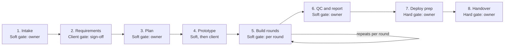

# Pipeline phases and gates

> Originally taken from a Claude Doc (2026-10-05) that has since been retired. The repo is the source of truth; this file reflects the owner-approved decisions recorded in `DECISIONS.md`. Agents change files in `docs/spec/` only after the owner approves a proposal in `docs/proposals/` (see `AGENTS.md`).

The pipeline has eight stages, and each one ends with a stored approval before the next begins. Machine-readable definitions: [stages.yaml](stages.yaml) and [gates.yaml](gates.yaml).

The client approves at the PRD and the prototype; every other gate is the owner's. Feedback sends an artifact back to its agent as a new version with the owner's notes. Reject marks the version rejected and starts no run; the owner then uses Feedback or edits by hand. The stage stays open until the owner accepts.

**Stage outputs:** intake record, PRD v1.0, plan with skill set, design brief, token budget and round scope, prototype screenshots, one pull request, preview and backlog per round, QC results and report, final screenshots, deployment checklist, handover guide (documentation, the handover document and a short note on how to ask for changes, with a PDF).

### Gate types

Every stage ends in one of three gate types. None advances automatically: the owner always acts, and a gate that waits longer than its `escalate_after_hours` (24 for every gate to start with) only shows an overdue badge in the approval queue.

| Gate type | Used for | Who acts | Notes |
| --- | --- | --- | --- |
| Soft | Reversible actions: intake, plan, prototype (owner review), build rounds, QC and report | Owner | Feedback sends notes back and the agent produces a new version; QC failures become a fix list |
| Hard | Irreversible actions: deploy prep, handover | Owner | Accept requires typing the project name in the console; there is no multi-factor (D-268) |
| Client | Client-attributed approvals: PRD lock, prototype sign-off | Client | Recorded as a client approval |

**Gate actions:** Accept approves and advances when no other gate of the stage is left; one database call (`accept_gate`) records the approval, marks the artifact approved and advances in a single transaction. After a client approval, or the last round approval, the project shows "Ready to advance" in the owner's queue and the owner is emailed; nothing advances until the owner clicks Advance. Feedback sends notes back and the agent produces a new version. Reject marks the version rejected and starts no run. Accept happens only in the console: merging a round's pull request in GitHub does not count as Accept (D-279). `accept_gate` and `advance_stage()` are callable only from an owner session, never by the service role or an agent (D-264).

**Gate classification:**

| Stage | Gate type | Gatekeeper | Escalate after |
| --- | --- | --- | --- |
| 1. Intake | Soft | Owner | 24 hours |
| 2. Requirements (PRD lock) | Client | Client; owner edits are part of the stage | 24 hours |
| 3. Plan | Soft | Owner | 24 hours |
| 4. Prototype | Soft, then Client (two approval records) | Owner, then client | 24 hours each |
| 5. Build rounds | Soft | Owner, each round | 24 hours |
| 6. QC and report | Soft | Owner; QC results and report approved together in one gate | 24 hours |
| 7. Deploy prep | Hard | Owner | 24 hours |
| 8. Handover | Hard | Owner | 24 hours |

Per-stage values live in `gate_config`: global defaults, with per-project overrides. `advance_stage()` honours the effective gatekeeper. Global rows cannot be deleted and only their deadline can change; a project row can add a gate or change a deadline but cannot change the gatekeeper of a global gate (D-272).

**Who approves, and edits after approval:** only an owner (soft and hard gates) or the project's named client signer (client gates) can approve; approval times are set by the database when the approval is written, together with the SHA-256 of the artifact's content and a snapshot of the giver's email (D-265, D-269); the client signs the prototype only after the owner approved the same version. A paused project must be resumed before anything is approved. While a stage is open, a new version of its artifact needs a fresh approval; once the project has advanced, new versions of that stage's artifacts are blocked, and the change goes through a change request (an accepted change request creates the new version).

**Loops and limits:**

- Prototype: at most 2 revision cycles. A cycle starts each time the owner sends feedback to the agent for a new prototype version; the first version does not count. Further changes need the owner's decision, for example a change request.
- Rounds: at most 3 Feedback loops per round, then the owner must Accept or Reject. After each approved round the Planner re-plans the remaining rounds and the owner approves the updated plan before the next round starts. A round's summary is an artifact of type `round_summary` carrying the round number; Feedback makes a new version of the same round's summary, and a round passes with a soft approval on its newest version.
- Feedback caps: at most 3 Feedback loops on intake review, PRD, plan, deploy prep and handover guide; after 3, only Accept or Reject is available.
- QC: at most 2 fix loops; after that the report lists the remaining issues for the owner to accept or fix manually.
- Paused: the owner can pause a project at any time; agents stop and data is kept. The owner can cancel a project from any stage before handover, with a typed confirmation and a reason and no export required; a cancelled project is closed and archived like a finished one, and the function that closes it sets its retention date.
- Cost: token use is shown as a progress bar against the project's token budget (tokens only, no dollar amounts, no warnings); the token budget never stops a run. Only the no-progress watchdog (see 15-operations.md) and the owner's Cancel stop a run.
**Closing and releases (D-220, D-223):** marking the handover complete moves the project to stage `closed`, sets status `closed` and reason `completed` in one `advance_stage()` call. After go-live and before close, each accepted change request is built as a mini-round and ends in a hard-gate deploy approval by the owner, attached to a release-note artifact. That approval is not a stage gate, so it can never advance or close the project; `advance_stage()` counts only approvals on the stage's own output artifacts. Marking the handover complete is refused while an accepted change request is undeployed (deploy, defer or decline it first). The owner-run transfer script sets a change-request freeze before it pushes, so no new change request is accepted after that.
